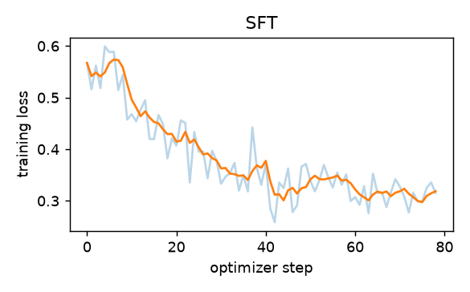
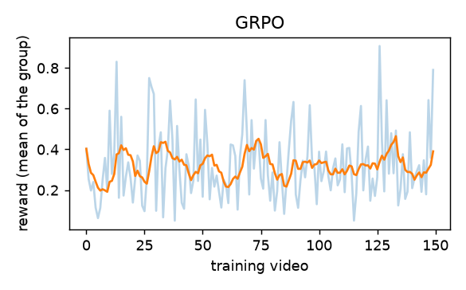

# Fine-tuning TRASER's language model: SFT and GRPO

Trained on **pvsg** (training split), tested on the other datasets (and on pvsg's test split, marked *in-domain*). Only TRASER's language model (Qwen2.5-VL-3B's decoder) is trained, with LoRA; the vision encoder and resamplers stay frozen. Code: `tools/finetune/`.

- **SFT**: copy the human answer (cross-entropy on the human relations written in TRASER's format).
- **GRPO**: write 4 answers per video, reward = triplet F1 + 0.5 x pair F1 against the human labels, favour the answers better than the group's mean (started from the SFT model).

Scores in % (lenient, temporal IoU > 0.5, as in the main benchmark). *pair recall* = human pairs (between objects it was given) that the answer mentions at all.

## vidor (not trained on), 300 videos

| model | triplet | relation | object | strict triplet | pair recall | relations / video | cut off | unjudged words |
|---|---|---|---|---|---|---|---|---|
| TRASER (no fine-tuning) | 11.5 | 13.2 | 86.4 | 1.1 | 41.2 | 11.5 | 0 | 0 |
| + SFT | 8.2 | 9.4 | 87.4 | 3.8 | 40.6 | 10.8 | 7 | 883 |
| + SFT + GRPO | 7.8 | 8.9 | 87.1 | 3.4 | 37.9 | 9.6 | 7 | 833 |

## pvsg (in-domain), 62 videos

| model | triplet | relation | object | strict triplet | pair recall | relations / video | cut off | unjudged words |
|---|---|---|---|---|---|---|---|---|
| TRASER (no fine-tuning) | 10.3 | 13.9 | 62.2 | 1.2 | 35.6 | 47.0 | 11 | 0 |
| + SFT | 9.4 | 11.4 | 66.5 | 5.7 | 40.5 | 42.6 | 7 | 735 |
| + SFT + GRPO | 10.1 | 12.3 | 66.5 | 5.8 | 43.7 | 32.8 | 5 | 759 |

**Notes.** Unjudged words count as wrong under lenient scoring (run with `--ask` and your own key to judge them). TRASER's answers are its saved run (float16, up to 8192 tokens, with attributes); the fine-tuned models write no attributes (the human labels have none) and up to 4096 tokens. PVSG training videos that are also VidOR test videos are left out of training.
