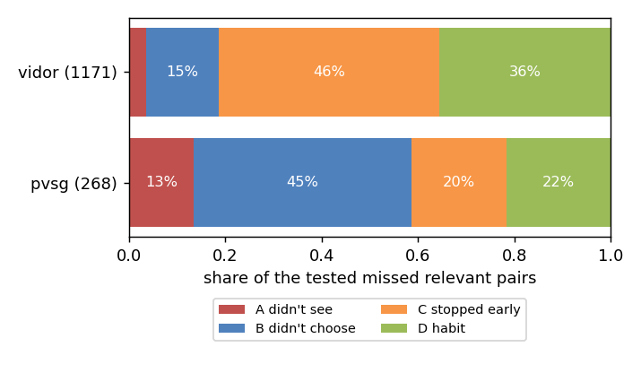
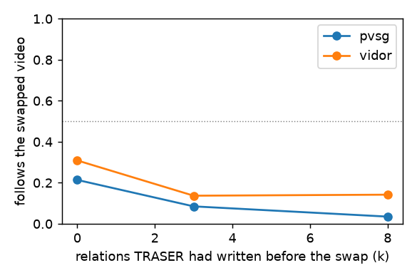
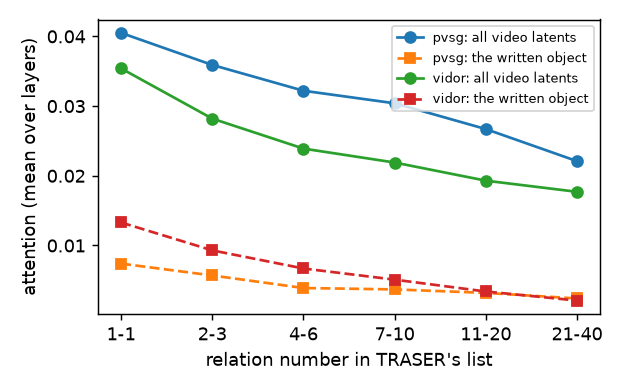

# Why does TRASER miss the relevant pairs? (pair experiment)

Relevant pair = a pair of objects that humans relate (ground truth) and that TRASER received. Code: `tools/interp/pairs_stage.py` (GPU) and `tools/interp/pairs_report.py` (this page). Ideas from *Are VLMs Seeing or Just Saying?* (swap the picture halfway, attention to the picture while writing, asking again as a new turn) and *Do Vision-Language Models Actually See?* (give the answer's structure as text to bypass seeing; easy-to-see things are found more often).

## The answer: why each missed pair was missed

| dataset | tested missed pairs | A didn't see | B didn't choose | C stopped early | D habit |
|---|---|---|---|---|---|
| pvsg | 276 | 12% | 46% | 19% | 23% |
| vidor | 1171 | 4% | 15% | 46% | 36% |

How a pair gets its reason (first rule that fits): **C** it writes the pair when the list is re-opened, when its subject is started for it, or when asked again in a new turn · **D** it fills in the human word (top 5) also with the video hidden, and the video adds less than 1 nat · **B** it fills in the human word with the video, or the probe reads "related" from its vectors · **A** none of these.

## 1. Is the pair inside the model? (probe vs habit)

| dataset | stage | TRASER's vectors | object names only (habit) | both | tricky pairs* | vectors on tricky | habit on tricky |
|---|---|---|---|---|---|---|---|
| pvsg | lm_30 | 0.866 | 0.8211 | 0.8517 | 2359 (600 related) | 0.7627 | 0.5847 |
| vidor | lm_30 | 0.8152 | 0.558 | 0.7761 | 6693 (3489 related) | 0.8102 | 0.5375 |

AUC: 0.5 = guessing, 1 = perfect. *Tricky pairs: the same two object names are related in some videos and not in others, so the names alone cannot tell. If TRASER's vectors beat the names there, it uses the video.

## 2. Give it the pair: does it fill in the right word?

We write `[subject, "` for it and score every relation word together with the human object. Human word (or an equivalent) in its top 5:

| dataset | pairs | with the video | video hidden | pair's objects hidden | picks the human object first (video / hidden) |
|---|---|---|---|---|---|
| pvsg | missed (276) | 64% | 58% | 58% | 36% / 24% |
| pvsg | written (131) | 73% | 70% | 70% | 53% / 45% |
| vidor | missed (1171) | 93% | 92% | 93% | 38% / 33% |
| vidor | written (741) | 96% | 95% | 96% | 50% / 47% |

Same answer with the video hidden = the word comes from habit. Good with the video but never written = it knew but did not choose.

### 2b. Every human pair of every video, with and without earlier text

*fresh* = every human pair (missed + written, no sampling) with no earlier relation (`"relationships": [[s, "`), so nothing can be copied from TRASER's own answer, which was written with the video; *answer* = the earlier setup: TRASER's answer re-opened, on every missed pair. Inputs: the video; every latent set to zero; every latent replaced by another video's latents (normal-looking vectors, wrong content). Human word: rank 1 / top 5 (exact word) / an equivalent in the top 5; object = the human object picked first after the human word; video raises = share of pairs where the video gives the human word a higher log-prob than this input (> 1 nat = 2.7x); AUC = the best word's log-prob separates related from non-related pairs.

| dataset | context | pairs | input | rank 1 | top 5 | top 5 (equiv.) | median rank | object first | video raises | > 1 nat | AUC related vs not |
|---|---|---|---|---|---|---|---|---|---|---|---|
| pvsg | fresh | related (739) | clean | 44% | 66% | 81% | 2 | 42% | - | - | 0.71 |
| pvsg | fresh | related (739) | other video | 33% | 57% | 76% | 4 | 24% | 62% | 48% | 0.60 |
| pvsg | fresh | related (739) | zeros | 35% | 57% | 75% | 3 | 29% | 56% | 34% | 0.63 |
| pvsg | fresh | missed (476) | clean | 37% | 58% | 75% | 3 | 29% | - | - | - |
| pvsg | fresh | missed (476) | other video | 30% | 51% | 70% | 5 | 16% | 57% | 43% | - |
| pvsg | fresh | missed (476) | zeros | 26% | 47% | 67% | 6 | 17% | 54% | 37% | - |
| pvsg | fresh | written (263) | clean | 56% | 80% | 91% | 1 | 64% | - | - | - |
| pvsg | fresh | written (263) | other video | 40% | 66% | 85% | 3 | 39% | 70% | 56% | - |
| pvsg | fresh | written (263) | zeros | 52% | 75% | 89% | 1 | 50% | 60% | 29% | - |
| pvsg | answer | related (355) | clean | 17% | 36% | 66% | 10 | 31% | - | - | - |
| pvsg | answer | related (355) | other video | 14% | 33% | 60% | 11 | 21% | 65% | 45% | - |
| pvsg | answer | related (355) | zeros | 13% | 32% | 61% | 11 | 20% | 64% | 42% | - |
| pvsg | answer | missed (355) | clean | 17% | 36% | 66% | 10 | 31% | - | - | - |
| pvsg | answer | missed (355) | other video | 14% | 33% | 60% | 11 | 21% | 65% | 45% | - |
| pvsg | answer | missed (355) | zeros | 13% | 32% | 61% | 11 | 20% | 64% | 42% | - |
| vidor | fresh | related (11157) | clean | 7% | 25% | 63% | 12 | 38% | - | - | 0.65 |
| vidor | fresh | related (11157) | other video | 8% | 26% | 64% | 13 | 31% | 38% | 26% | 0.57 |
| vidor | fresh | related (11157) | zeros | 10% | 36% | 72% | 9 | 32% | 26% | 15% | 0.56 |
| vidor | fresh | missed (6528) | clean | 7% | 22% | 57% | 13 | 30% | - | - | - |
| vidor | fresh | missed (6528) | other video | 8% | 24% | 60% | 14 | 26% | 36% | 25% | - |
| vidor | fresh | missed (6528) | zeros | 10% | 31% | 66% | 11 | 25% | 27% | 15% | - |
| vidor | fresh | written (4629) | clean | 8% | 30% | 72% | 11 | 49% | - | - | - |
| vidor | fresh | written (4629) | other video | 8% | 30% | 71% | 12 | 38% | 41% | 27% | - |
| vidor | fresh | written (4629) | zeros | 11% | 42% | 82% | 7 | 42% | 26% | 14% | - |
| vidor | answer | related (6528) | clean | 26% | 74% | 94% | 3 | 31% | - | - | - |
| vidor | answer | related (6528) | other video | 22% | 67% | 92% | 4 | 28% | 51% | 29% | - |
| vidor | answer | related (6528) | zeros | 20% | 65% | 92% | 4 | 28% | 55% | 30% | - |
| vidor | answer | missed (6528) | clean | 26% | 74% | 94% | 3 | 31% | - | - | - |
| vidor | answer | missed (6528) | other video | 22% | 67% | 92% | 4 | 28% | 51% | 29% | - |
| vidor | answer | missed (6528) | zeros | 20% | 65% | 92% | 4 | 28% | 55% | 30% | - |

If the video mattered little, *clean* and *other video* would look the same, also in the *fresh* context. A large gap only in *fresh* means the earlier text carries the video's information in *answer*.

## 3. Keep writing, and swap the video halfway

| dataset | videos | new relations when the list is re-opened | of them human pairs | missed pairs tested | come back: re-opened list | subject started for it | asked again (new turn) |
|---|---|---|---|---|---|---|---|
| pvsg | 52 | 418 | 45 | 276 | 9% | 12% | 3% |
| vidor | 300 | 1384 | 706 | 1171 | 15% | 32% | 18% |

Swap: the visual contents of TRASER's two most-used objects are exchanged in the input after it has written k relations. Following the swapped video = it still looks; following its earlier text = it stopped looking (VisualSwap's finding).

| dataset | k | follows swapped video | follows old text | videos |
|---|---|---|---|---|
| pvsg | 0 | 9 | 33 | 52 |
| pvsg | 3 | 7 | 75 | 52 |
| pvsg | 8 | 3 | 83 | 52 |
| vidor | 0 | 104 | 233 | 300 |
| vidor | 3 | 55 | 346 | 269 |
| vidor | 8 | 38 | 229 | 165 |

## 4. Where does it look while writing?

| dataset | relation no. | all video latents | the written object's latents | (if spread evenly) | answer so far | n |
|---|---|---|---|---|---|---|
| pvsg | 1-1 | 0.0406 | 0.0071 | 0.0614 | 0.5117 | 55 |
| pvsg | 2-3 | 0.0363 | 0.0052 | 0.0565 | 0.5584 | 110 |
| pvsg | 4-6 | 0.0327 | 0.004 | 0.0585 | 0.5802 | 162 |
| pvsg | 7-10 | 0.0311 | 0.0043 | 0.0576 | 0.5895 | 202 |
| pvsg | 11-20 | 0.027 | 0.0035 | 0.0552 | 0.6091 | 437 |
| pvsg | 21-40 | 0.0233 | 0.0025 | 0.0511 | 0.6285 | 402 |
| vidor | 1-1 | 0.0345 | 0.0134 | 0.1926 | 0.496 | 300 |
| vidor | 2-3 | 0.0281 | 0.01 | 0.1838 | 0.5444 | 585 |
| vidor | 4-6 | 0.0239 | 0.0074 | 0.161 | 0.5658 | 752 |
| vidor | 7-10 | 0.0216 | 0.0052 | 0.1252 | 0.5888 | 705 |
| vidor | 11-20 | 0.0191 | 0.0034 | 0.0855 | 0.6142 | 808 |
| vidor | 21-40 | 0.0178 | 0.0024 | 0.0529 | 0.6372 | 268 |

When it closes the list, attention to the objects of the pairs it missed:

| dataset | missed pairs' latents | (if spread evenly) | other latents | answer so far | n |
|---|---|---|---|---|---|
| pvsg | 0.0065 | 0.3106 | 0.0057 | 0.6796 | 33 |
| vidor | 0.0084 | 0.4482 | 0.0022 | 0.6332 | 299 |

## 5. Which relevant pairs are missed?

Miss rate in the lowest vs highest third of each fact (logistic-regression weight: + = more misses):

| dataset | fact | miss rate, low third | high third | weight |
|---|---|---|---|---|
| pvsg | time together | 71% | 66% | 0.579 |
| pvsg | gap | 81% | 56% | 0.071 |
| pvsg | touching | 73% | 58% | -0.179 |
| pvsg | size (subject) | 72% | 58% | 0.34 |
| pvsg | size (object) | 74% | 57% | -0.012 |
| pvsg | speed (subject) | 62% | 62% | 0.218 |
| pvsg | speed (object) | 58% | 64% | 0.013 |
| pvsg | tokens (subject) | 67% | 66% | -0.402 |
| pvsg | tokens (object) | 71% | 66% | -0.335 |
| pvsg | living (object) | 64% | 64% | 0.029 |
| pvsg | objects in video | 56% | 80% | 0.784 |
| pvsg | action word | 69% | 62% | -0.06 |
| pvsg | name pair is common | 62% | 70% | 0.284 |
| vidor | time together | 67% | 50% | -0.033 |
| vidor | gap | 47% | 70% | 0.123 |
| vidor | touching | 70% | 46% | -0.099 |
| vidor | size (subject) | 68% | 47% | 0.044 |
| vidor | size (object) | 62% | 55% | -0.032 |
| vidor | speed (subject) | 61% | 61% | -0.125 |
| vidor | speed (object) | 56% | 64% | 0.021 |
| vidor | tokens (subject) | 70% | 48% | -0.226 |
| vidor | tokens (object) | 62% | 56% | 0.006 |
| vidor | objects in video | 47% | 73% | 0.453 |
| vidor | action word | 64% | 41% | -0.192 |
| vidor | name pair is common | 56% | 64% | 0.194 |

**Caveats.** The human labels are incomplete, so some "unrelated" pairs are really related. Only a sample of missed pairs per video is tested (8 by default). The reasons are rules on these measurements, not certainties.
