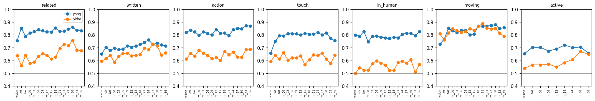
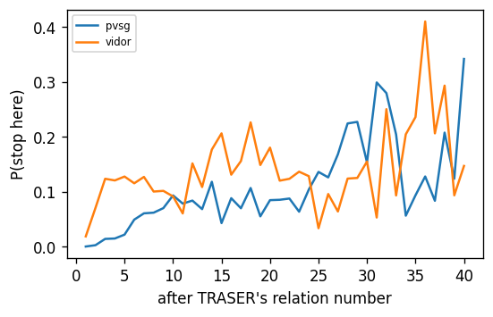
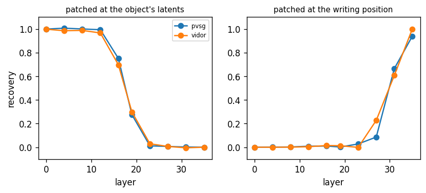
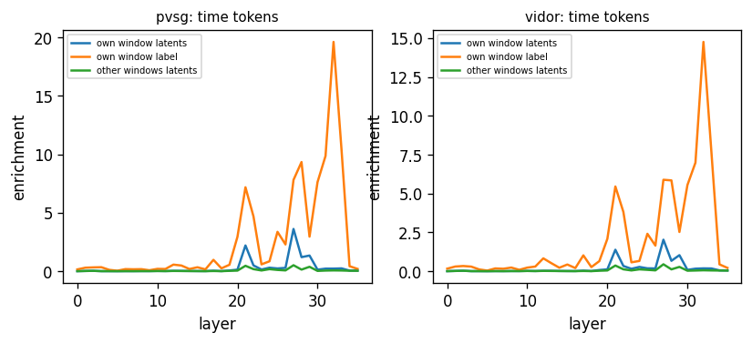

# TRASER interpretability report

Made by `tools/interp/` (stage 1 `encode_stage.py`, stage 2 `lm_stage.py`, `probe.py`, this `report.py`). Raw results per video are in `raw/<phase>/<dataset>/`. Everything is measured on TRASER's released checkpoint and its own saved answers.

## 0. Check: the harness reproduces TRASER

The language model alone (exported weights) on the saved input sequences, compared with TRASER's saved answers. *Greedy*: how many of the first 300 tokens it writes again identically. *Teacher-forced*: how often its most likely next token is TRASER's token, over the whole answer. High values mean every experiment below works on the same model and input that produced the answers.

| dataset | video | greedy: same first tokens | teacher-forced agreement |
|---|---|---|---|
| pvsg | 0018_4748191834 | 300/300 | 97% |
| pvsg | 0046_11919433184 | 300/300 | 98% |
| vidor | 10024067406 | 189/189 | 98% |
| vidor | 11244289523 | 300/300 | 97% |

## 1. Where is the information? (probes)

ROC AUC of a small classifier trained on TRASER's vectors at each stage (0.5 = chance, 1 = perfect; tested on videos it was not trained on). `vision` = vision encoder tokens of the object, `otr` / `twr` = the two resamplers' latents, `lm_L` = the language model after layer L (over the object's latents). Where a row drops, the information is lost; where it stays high but TRASER still misses relations, the information is there and not used.

### pvsg (25 videos)

| question | n (positives) | vision | otr | twr | lm_00 | lm_03 | lm_06 | lm_09 | lm_12 | lm_15 | lm_18 | lm_21 | lm_24 | lm_27 | lm_30 | lm_33 | lm_36 |
|---|---|---|---|---|---|---|---|---|---|---|---|---|---|---|---|---|---|
| pair: do humans relate subject → object | 3020 (302) | 0.76 | 0.85 | 0.79 | 0.82 | 0.83 | 0.84 | 0.83 | 0.83 | 0.82 | 0.85 | 0.83 | 0.83 | 0.84 | 0.86 | 0.84 | 0.83 |
| pair: did TRASER write the pair | 3020 (332) | 0.65 | 0.70 | 0.68 | 0.70 | 0.69 | 0.69 | 0.71 | 0.70 | 0.71 | 0.73 | 0.74 | 0.76 | 0.72 | 0.74 | 0.72 | 0.71 |
| pair (related): action word vs only position words | 302 (199) | 0.82 | 0.84 | 0.82 | 0.80 | 0.82 | 0.81 | 0.80 | 0.84 | 0.81 | 0.81 | 0.79 | 0.84 | 0.85 | 0.85 | 0.87 | 0.87 |
| pair: do the masks touch | 2556 (1542) | 0.66 | 0.75 | 0.79 | 0.79 | 0.81 | 0.81 | 0.81 | 0.80 | 0.81 | 0.81 | 0.81 | 0.82 | 0.80 | 0.82 | 0.77 | 0.75 |
| object: in any human relation | 456 (246) | 0.80 | 0.79 | 0.83 | 0.75 | 0.79 | 0.79 | 0.78 | 0.78 | 0.77 | 0.78 | 0.78 | 0.81 | 0.81 | 0.81 | 0.79 | 0.83 |
| object: moving fast vs slow | 284 (142) | 0.73 | 0.77 | 0.85 | 0.83 | 0.82 | 0.83 | 0.83 | 0.80 | 0.81 | 0.87 | 0.87 | 0.87 | 0.87 | 0.88 | 0.85 | 0.86 |
| window: is the relation happening in this 4-second window | 3344 (2127) | 0.65 | · | 0.70 | 0.70 | · | 0.67 | · | 0.69 | · | 0.72 | · | 0.70 | · | 0.71 | · | 0.66 |

Controls for *related*: shuffled labels 0.52; geometry only (on screen together, gap, touching, sizes, motion, tokens, person/animal) 0.90; geometry + `lm_30` 0.88.

**Known but not written?** At `lm_30` (best stage for *related*), 54% of the 183 human pairs TRASER did *not* write score above 90% of unrelated pairs, vs 70% of the 119 pairs it did write.

### vidor (60 videos)

| question | n (positives) | vision | otr | twr | lm_00 | lm_03 | lm_06 | lm_09 | lm_12 | lm_15 | lm_18 | lm_21 | lm_24 | lm_27 | lm_30 | lm_33 | lm_36 |
|---|---|---|---|---|---|---|---|---|---|---|---|---|---|---|---|---|---|
| pair: do humans relate subject → object | 1828 (764) | 0.64 | 0.56 | 0.64 | 0.58 | 0.59 | 0.63 | 0.65 | 0.64 | 0.61 | 0.63 | 0.69 | 0.73 | 0.72 | 0.76 | 0.68 | 0.68 |
| pair: did TRASER write the pair | 1828 (536) | 0.59 | 0.61 | 0.64 | 0.59 | 0.63 | 0.65 | 0.66 | 0.64 | 0.64 | 0.65 | 0.70 | 0.69 | 0.73 | 0.71 | 0.64 | 0.66 |
| pair (related): action word vs only position words | 764 (181) | 0.61 | 0.66 | 0.63 | 0.68 | 0.66 | 0.64 | 0.61 | 0.62 | 0.60 | 0.67 | 0.64 | 0.67 | 0.63 | 0.63 | 0.69 | 0.69 |
| pair: do the masks touch | 1352 (542) | 0.59 | 0.64 | 0.61 | 0.66 | 0.60 | 0.62 | 0.62 | 0.64 | 0.57 | 0.61 | 0.64 | 0.64 | 0.66 | 0.61 | 0.57 | 0.64 |
| object: in any human relation | 304 (276) | 0.50 | 0.54 | 0.52 | 0.52 | 0.58 | 0.60 | 0.58 | 0.57 | 0.52 | 0.52 | 0.58 | 0.59 | 0.58 | 0.61 | 0.51 | 0.57 |
| object: moving fast vs slow | 188 (94) | 0.81 | 0.76 | 0.82 | 0.85 | 0.83 | 0.82 | 0.83 | 0.85 | 0.83 | 0.87 | 0.89 | 0.86 | 0.85 | 0.85 | 0.81 | 0.79 |
| window: is the relation happening in this 4-second window | 3741 (3324) | 0.54 | · | 0.57 | 0.57 | · | 0.57 | · | 0.55 | · | 0.58 | · | 0.61 | · | 0.67 | · | 0.65 |

Controls for *related*: shuffled labels 0.50; geometry only (on screen together, gap, touching, sizes, motion, tokens, person/animal) 0.90; geometry + `lm_30` 0.85.

**Known but not written?** At `lm_30` (best stage for *related*), 37% of the 428 human pairs TRASER did *not* write score above 90% of unrelated pairs, vs 46% of the 336 pairs it did write.

## 2. Does it know relations it does not write? (forced continuation)

After TRASER's last relation we start one more, with the subject of a human relation, and score every possible next piece exactly: the subject number among all objects, the relation word among the dataset's common words, the object number among all objects. *missed* = human relations whose pair TRASER never wrote; *written* = ones it wrote with the right word (should rank high); *control* = a random other object / word in the same slot.

| dataset | relations | subject: median rank (control) | word: in top 5 (control) | word: same-meaning word in top 5 | object: rank 1 (control) | object: top 3 (control) | **all three** (control) |
|---|---|---|---|---|---|---|---|
| pvsg missed | 137 | 5 (8) | 23% (3%) | 43% | 34% (5%) | 61% (21%) | **12%** (0%) |
| pvsg written | 73 | 2 (8) | 40% (4%) | 68% | 40% (5%) | 59% (23%) | **26%** (0%) |
| vidor missed | 329 | 4 (3) | 53% (4%) | 75% | 35% (20%) | 76% (66%) | **31%** (2%) |
| vidor written | 188 | 2 (3) | 49% (6%) | 81% | 49% (16%) | 76% (65%) | **49%** (3%) |

*all three* = subject in the top 3, word in the top 5 (or a same-meaning word), object in the top 3.

**Stopping.** Probability that TRASER closes its relation list, at the point where it did: pvsg mean 59%; vidor mean 70%.

## 3. What does each part of the input do? (interventions)

Change in log-probability (nats; negative = TRASER's own answer became less likely) of each part of its relations when part of the input is removed (set to zero). Teacher-forced on TRASER's answer, so the answer itself does not change.

| dataset | removed | subject number | relation word | object number | times | relations |
|---|---|---|---|---|---|---|
| pvsg | all visual latents | -0.17 | -0.21 | -0.38 | -0.58 | 582 |
| pvsg | OTR latents only (whole-video summary) | -0.06 | -0.11 | -0.13 | -0.10 | 582 |
| pvsg | TWR latents only (4-second windows) | -0.01 | -0.04 | -0.15 | -0.37 | 582 |
| pvsg | time labels reversed | -0.03 | -0.05 | -0.16 | -1.34 | 582 |
| vidor | all visual latents | -0.16 | -0.46 | -0.15 | -0.31 | 792 |
| vidor | OTR latents only (whole-video summary) | -0.07 | -0.22 | -0.05 | -0.05 | 792 |
| vidor | TWR latents only (4-second windows) | -0.05 | -0.07 | -0.04 | -0.19 | 792 |
| vidor | time labels reversed | -0.08 | -0.12 | -0.10 | -1.26 | 792 |

**Which relation words need the video?** Change of the relation word's log-probability with all visual latents removed:

| dataset | position words | other words | top words (change) |
|---|---|---|---|
| pvsg | -0.15 | -0.25 | in front of -0.11, holding -0.41, riding -0.03, on -0.16, approaching -0.32, moving away from -0.01, looking at -0.19, placing -0.29 |
| vidor | -0.24 | -0.80 | in front of -0.17, approaches -0.98, near -0.35, moves away from -0.18, looking at -0.99, holding -0.79, on -0.43, behind -0.62 |

**Removing one object.** Mean change for relations that involve the removed object vs relations that do not (if the model reads each object from its own latents, only the first should drop):

| dataset | involving it: object number | involving it: word | not involving it: object number | not involving it: word |
|---|---|---|---|---|
| pvsg | -0.22 | -0.10 | -0.00 | -0.00 |
| vidor | -0.13 | -0.16 | -0.01 | -0.02 |

**Where do the times come from?** The time labels `<a - b sec>` are reversed (the first window gets the last label, ...) while the video latents stay. We compare TRASER's times with the same times moved to where the reversed labels would put them. If times are read from the labels, the moved times become the more likely ones.

| dataset | relations | clean labels: original times preferred | reversed labels: moved times preferred | mean preference for moved times (clean → reversed, nats) |
|---|---|---|---|---|
| pvsg | 576 | 87% | 30% | -3.08 → -0.98 |
| vidor | 740 | 92% | 30% | -3.01 → -0.92 |

**Windows of a relation.** Removing the TWR latents of both objects in the windows where the relation happens, vs in the same number of other windows of the same two objects:

| dataset | tests | times: own windows | times: other windows | word: own windows | word: other windows |
|---|---|---|---|---|---|
| pvsg | 34 | -0.65 | -0.03 | -0.05 | 0.00 |
| vidor | 58 | -0.76 | 0.01 | -0.07 | -0.05 |

## 4. Where is the object decided? (activation patching)

One object of a relation TRASER wrote is removed (its latents set to zero), which makes the object number less likely. Then its clean hidden states are put back at one layer only: *at its latents* (does the model still need the object's own positions at that layer?) or *at the position that writes the number* (has the decision been assembled there by that layer?). Recovery = share of the lost log-probability that comes back (1 = all).

**pvsg** (12 relations; mean drop when removed 1.80 nats)

| layer | 0 | 4 | 8 | 12 | 16 | 19 | 23 | 27 | 31 | 35 |
|---|---|---|---|---|---|---|---|---|---|---|
| at its latents | 1.00 | 1.01 | 1.00 | 0.99 | 0.75 | 0.28 | 0.01 | 0.01 | 0.00 | 0.00 |
| at the writing position | -0.00 | 0.00 | 0.00 | 0.01 | 0.01 | 0.00 | 0.03 | 0.09 | 0.66 | 0.94 |

**vidor** (6 relations; mean drop when removed 1.25 nats)

| layer | 0 | 4 | 8 | 12 | 16 | 19 | 23 | 27 | 31 | 35 |
|---|---|---|---|---|---|---|---|---|---|---|
| at its latents | 1.00 | 0.98 | 0.99 | 0.97 | 0.70 | 0.30 | 0.03 | 0.01 | -0.00 | 0.00 |
| at the writing position | 0.00 | -0.00 | 0.00 | 0.00 | 0.01 | 0.01 | -0.00 | 0.23 | 0.61 | 1.00 |

## 5. Where do the written tokens look? (attention)

Attention (averaged over heads) from the position that writes each token. Shown as *enrichment*: the share of attention a part of the input gets divided by its share of the positions (1 = no preference, 10 = ten times more than its size). Only answers + inputs up to the length limit.

**Tokens that write a **time**** (middle and last layers; mass / enrichment)

*pvsg* (4 videos)

| part of the input | layer 18 | layer 35 |
|---|---|---|
| own window latents | 0% / 0.0× | 0% / 0.1× |
| own window label | 0% / 0.2× | 0% / 0.2× |
| other windows latents | 0% / 0.0× | 0% / 0.0× |
| own otr | 0% / 0.1× | 0% / 0.1× |
| other labels | 2% / 0.2× | 2% / 0.2× |
| other objects | 1% / 0.0× | 2% / 0.0× |
| object markers | 2% / 0.7× | 9% / 3.1× |
| answer | 70% / 3.3× | 70% / 3.4× |
| prompt | 24% / 24.1× | 16% / 15.9× |

*vidor* (20 videos)

| part of the input | layer 18 | layer 35 |
|---|---|---|
| own window latents | 0% / 0.0× | 0% / 0.0× |
| own window label | 0% / 0.3× | 0% / 0.2× |
| other windows latents | 0% / 0.0× | 1% / 0.0× |
| own otr | 1% / 0.2× | 0% / 0.1× |
| other labels | 2% / 0.2× | 2% / 0.2× |
| other objects | 1% / 0.0× | 1% / 0.0× |
| object markers | 2% / 0.5× | 9% / 3.0× |
| answer | 70% / 3.1× | 65% / 2.8× |
| prompt | 24% / 15.0× | 22% / 12.5× |

**Tokens that write an **object number**** (middle and last layers; mass / enrichment)

*pvsg* (4 videos)

| part of the input | layer 18 | layer 35 |
|---|---|---|
| named object block | 1% / 0.1× | 1% / 0.2× |
| other objects | 4% / 0.1× | 10% / 0.1× |
| answer | 64% / 3.0× | 77% / 3.7× |
| prompt | 32% / 31.2× | 12% / 11.4× |

*vidor* (20 videos)

| part of the input | layer 18 | layer 35 |
|---|---|---|
| named object block | 1% / 0.1× | 2% / 0.1× |
| other objects | 3% / 0.1× | 9% / 0.2× |
| answer | 62% / 2.7× | 74% / 3.3× |
| prompt | 33% / 20.4× | 15% / 8.7× |

**Tokens that write a **relation word**** (middle and last layers; mass / enrichment)

*pvsg* (4 videos)

| part of the input | layer 18 | layer 35 |
|---|---|---|
| subject and object | 0% / 0.0× | 1% / 0.1× |
| other objects | 1% / 0.0× | 2% / 0.0× |
| labels and markers | 3% / 0.2× | 12% / 0.7× |
| answer | 66% / 3.2× | 69% / 3.4× |
| prompt | 30% / 30.0× | 16% / 15.9× |

*vidor* (20 videos)

| part of the input | layer 18 | layer 35 |
|---|---|---|
| subject and object | 1% / 0.0× | 1% / 0.1× |
| other objects | 1% / 0.0× | 1% / 0.0× |
| labels and markers | 3% / 0.2× | 12% / 0.8× |
| answer | 66% / 3.0× | 65% / 2.9× |
| prompt | 30% / 19.1× | 21% / 12.3× |

Relations naming an object number that is not in the input: 0 (in the videos with attention).

